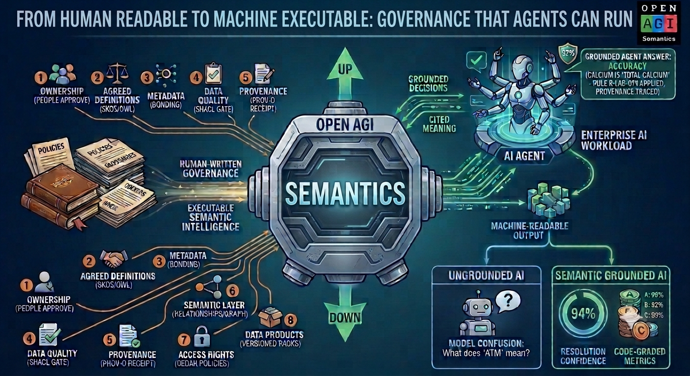
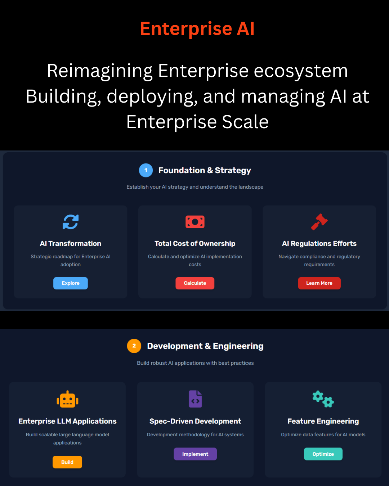
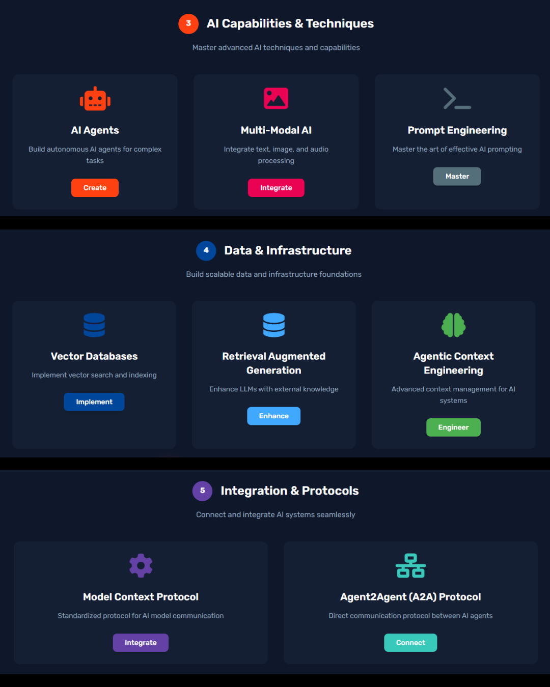
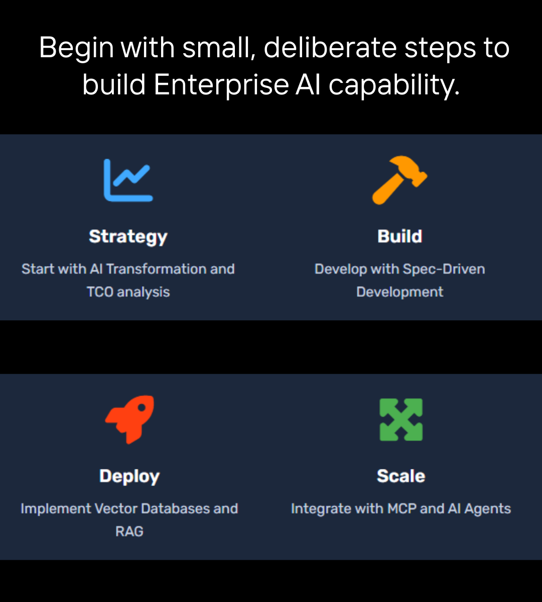

# Open AGI Stack

### Intelligence into the products

**The Semantic Intelligence layer for enterprise AI**

*From AI that sounds right to AI that understands.*
*Give your AI the context your people already carry.*

### Start with ready-made ontology starter packs, such as Enterprise Core and Industry related packs like Healthcare Core, written in Turtle or RDF/XML. Then shape them into a semantic intelligence that is fully yours.

------------------------------------------------------------------------------------------------------------------------------------

Read [https://www.openagistack.com/articles/open-agi-stack-semantic-article/](https://www.openagistack.com/articles/open-agi-stack-semantic-article/)
------------------------------------------------------------------------------------------------------------------------------------

---

## 🛠️ Modern Engineering: How We Do It

*A deep dive into the engineering practices and technical standards that power our AI development lifecycle—engineered for transparency, velocity, and optimized Total Cost of Ownership (TCO).*

 

### 1. 🤖 AI-Blended Development & Forward Deployed Engineering
*Human-AI pair programming at scale and client-embedded delivery.*

- **Spec-to-Code Technical Coaching**: Reimagining software creation from manual typing to active technical coaching. AI agents generate blueprints and pull requests while human architects guide high-level intent and verify boundaries.
- **Forward Deployed Immersion (FDE)**: Eliminating the enterprise "lost in translation" gap by embedding directly within business operations to uncover informal workflows and prototype solutions in rapid, real-time loops.
- **Velocity Without Regression**: Doubling implementation velocity while maintaining zero regressions on core business logic through spec-driven analysis.

---

### 2. 🏗️ Platform Engineering & Shift-Left Quality
*Golden paths to production and moving verification upstream.*

- **Self-Service Golden Paths**: Pre-vetted, secure, automated routes to production that eliminate developer toil and cognitive load—provisioning compliant infrastructure and CI/CD pipelines in minutes.
- **Guardrails Over Gates**: Replacing slow manual approval checkpoints with deterministic, automated guardrails that prevent non-compliant architectures from ever building.
- **Shift-Left Quality at Source**: Catching defects in the local IDE with automated static analysis, security scanning, and architectural linting before a PR is opened.

---

### 3. 🛡️ Shift-Right Resilience, Observability & API-First Mesh
*Real-world validation, high-definition telemetry, and contract-driven agent coordination.*

- **Shift-Right & Semantic Validation**: Canary rollouts, chaos engineering, and continuous telemetry in production to detect real-world model drift, semantic misalignment, and edge-case failures.
- **Observability-Driven Development (ODD)**: Developing for debugging. High-definition logging, metrics, and distributed tracing that explain *why* multi-agent interactions behave the way they do, minimizing MTTR.
- **API-First Agent Mesh**: Contracts before code. Formal OpenAPI and schema specifications decoupling services and allowing specialized AI agents to interact with predictable interoperability.

---

**Open AGI Stack Semantics** · Semantic Intelligence for enterprise AI

