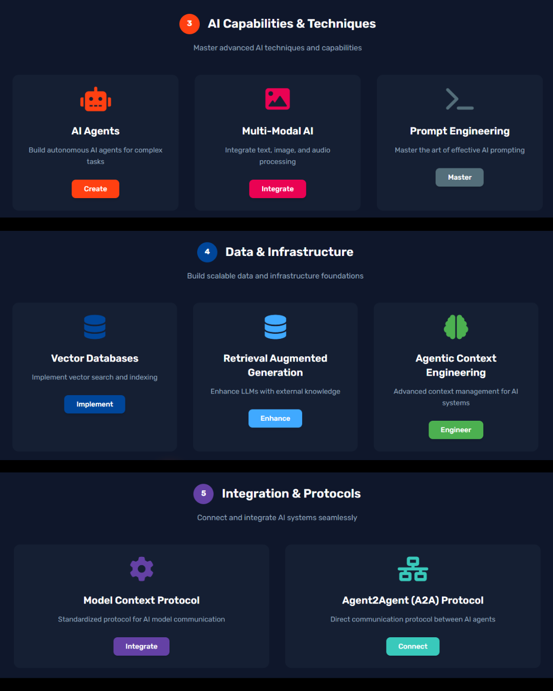

<!--
**amitpuri/amitpuri** is a ✨ _special_ ✨ repository because its `README.md` (this file) appears on your GitHub profile.

Here are some ideas to get you started:
-->

# Open AGI Stack Semantic
## Intelligence into the products
### The Semantic Intelligence for enterprise AI

### From AI that sounds right to AI that understands. Give your AI the context your people already carry. 

### Start with ready-made ontology starter packs, such as Enterprise Core and Healthcare Core, written in Turtle or RDF/XML. Then shape them into a semantic intelligence that is fully yours.

------------------------------------------------------------------------------------------------------------------------------------

------------------------------------------------------------------------------------------------------------------------------------

------------------------------------------------------------------------------------------------------------------------------------

------------------------------------------------------------------------------------------------------------------------------------

------------------------------------------------------------------------------------------------------------------------------------
